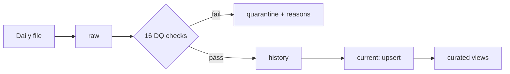

# Support Ops Assistant

[](https://github.com/patilkishore0512-ctrl/support-ops-assistant/actions/workflows/ci.yml)

An internal assistant for a customer-support platform, built from two data sources:

1. **Structured**: daily support-ticket exports, cleaned and loaded into DuckDB by an idempotent pipeline.
2. **Unstructured**: knowledge-base articles, indexed for retrieval-augmented question answering.

| Part | What | Status | Docs |
|---|---|---|---|
| A | Data pipeline: raw → cleaned → curated, 16 DQ checks, quarantine, schema drift, upserts | ✅ Done | [docs/part-a-pipeline.md](docs/part-a-pipeline.md) |
| B | RAG service: FastAPI `/ingest` and `/ask`, hybrid retrieval, SQL tool, guardrails | 🚧 In progress | |
| C | Evaluation: golden set, retrieval and answer metrics, experiment | ⏳ Planned | |
| D | Design note: scale, deployment, risks | ⏳ Planned | |

## Quick start

Requires Python 3.11+.

```bash
git clone https://github.com/patilkishore0512-ctrl/support-ops-assistant.git
cd support-ops-assistant

python -m venv .venv
source .venv/bin/activate        # Windows: .venv\Scripts\activate

make setup                       # install dependencies
make all                         # generate data -> run pipeline -> print report -> run tests
```

No `make`? See the commands in [docs/part-a-pipeline.md](docs/part-a-pipeline.md#how-to-run).

## Repository layout

```
.
├── src/
│   └── pipeline/              Part A: ingestion, cleaning, DQ checks, curated views, CLI
├── scripts/
│   └── generate_tickets.py    synthetic ticket generator (deliberate quality problems)
├── data/
│   ├── incoming/              daily ticket files
│   └── reference/             customers and agents
├── outputs/
│   └── pipeline/              sample outputs from a full run
├── tests/
│   └── pipeline/              unit and integration tests
├── docs/                      detailed write-up per part, AI usage
├── .github/workflows/ci.yml   tests + end-to-end pipeline run on every push
├── Makefile
├── pyproject.toml
├── requirements.txt
└── .env.example
```

## Part A at a glance



- **5,520** synthetic rows over 3 days, with duplicates, 5 date formats, invalid values, broken references, late updates, stale versions and a new column on day 3.
- **Idempotent**: re-running a day is a no-op; `--force` gives an identical result.
- **Upsert**: newer versions replace older ones; stale versions arriving late are ignored.
- **Nothing silently dropped**: 459 bad rows quarantined with their reasons; every check result is logged.
- **Curated**: average/median/p90 resolution time per product, weekly backlog per priority.

Sample outputs: [`outputs/pipeline/`](outputs/pipeline/).

## Use of AI coding assistants

See [docs/ai-usage.md](docs/ai-usage.md).
