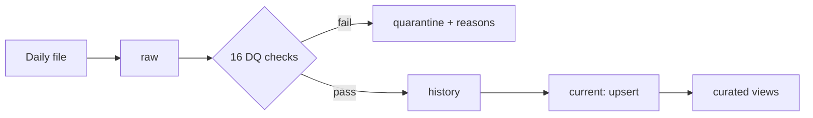
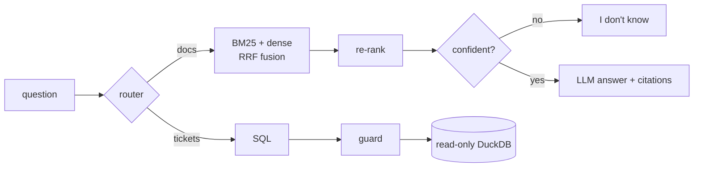

# Support Ops Assistant

[](https://github.com/patilkishore0512-ctrl/support-ops-assistant/actions/workflows/ci.yml)

An internal assistant for a customer-support platform, built from two data sources:

1. **Structured**: daily support-ticket exports, cleaned and loaded into DuckDB by an idempotent pipeline.
2. **Unstructured**: knowledge-base articles, indexed for retrieval-augmented question answering.

| Part | What | Status | Docs |
|---|---|---|---|
| A | Data pipeline: raw → cleaned → curated, 16 DQ checks, quarantine, schema drift, upserts | ✅ Done | [docs/part-a-pipeline.md](docs/part-a-pipeline.md) |
| B | RAG service: FastAPI `/ingest` and `/ask`, hybrid retrieval + re-ranking, guarded SQL tool, guardrails, Docker | ✅ Done | [docs/part-b-rag-service.md](docs/part-b-rag-service.md) |
| C | Evaluation: 34-question golden set, retrieval/answer/abstention metrics, retrieval and chunk-size experiments | ✅ Done | [docs/part-c-evaluation.md](docs/part-c-evaluation.md) |
| D | Design note: 100× scale, Azure deployment and monitoring, top risks, next week | ✅ Done | [docs/design-note.md](docs/design-note.md) |

## Quick start

**Docker** (nothing else to install):

```bash
git clone https://github.com/patilkishore0512-ctrl/support-ops-assistant.git
cd support-ops-assistant
docker compose up --build        # builds the ticket store + index, serves the API
```

Open http://localhost:8000/docs, or:

```bash
curl -X POST localhost:8000/ask -H "content-type: application/json" \
     -d '{"question": "How do I configure CORSMiddleware to allow my frontend origin?"}'
curl -X POST localhost:8000/ask -H "content-type: application/json" \
     -d '{"question": "What is the average resolution time per product?"}'
```

**Local** (Python 3.11+):

```bash
python -m venv .venv
source .venv/bin/activate        # Windows: .venv\Scripts\activate

make setup                       # install dependencies
make all                         # data -> pipeline -> report -> index -> tests
make serve                       # API on http://localhost:8000
```

No API key is needed: the default LLM is a documented offline mock. Set `LLM_PROVIDER` in `.env` to use OpenAI or Anthropic (see [`.env.example`](.env.example)).

**New here?** The [walkthrough](docs/walkthrough.md) runs every part step by step, with the real output of each command (about 15 minutes, no keys or downloads).

No `make`? See the commands in [Part A](docs/part-a-pipeline.md#how-to-run) and [Part B](docs/part-b-rag-service.md#how-to-run).

## Repository layout

```
.
├── src/
│   ├── pipeline/              Part A: ingestion, cleaning, DQ checks, curated views, CLI
│   └── rag_service/           Part B: FastAPI app, chunking, hybrid retrieval, SQL tool, guardrails
├── scripts/
│   ├── generate_tickets.py    synthetic ticket generator (deliberate quality problems)
│   ├── docker-entrypoint.sh   container start: build ticket store + index if missing, serve
│   └── smoke_test.py          end-to-end check against a running service
├── data/
│   ├── incoming/              daily ticket files
│   ├── reference/             customers and agents
│   └── kb/                    74 FastAPI docs articles + manifest (URL, last updated)
├── outputs/
│   ├── pipeline/              sample outputs from a full pipeline run
│   └── rag/                   sample /ask responses
├── evaluation/                Part C: golden set, metrics, runner, results
├── tests/
│   ├── pipeline/              Part A tests
│   ├── rag_service/           Part B tests
│   └── evaluation/            metric and golden-set tests
├── docs/                      detailed write-up per part, AI usage
├── .github/workflows/         CI (tests, pipeline, API + Docker smoke tests, offline eval), real-model eval
├── Dockerfile
├── docker-compose.yml
├── Makefile
├── pyproject.toml
├── requirements*.txt          runtime / models (optional) / dev
└── .env.example
```

## Part A at a glance



- **5,520** synthetic rows over 3 days, with duplicates, 5 date formats, invalid values, broken references, late updates, stale versions and a new column on day 3.
- **Idempotent**: re-running a day is a no-op; `--force` gives an identical result.
- **Upsert**: newer versions replace older ones; stale versions arriving late are ignored.
- **Nothing silently dropped**: 459 bad rows quarantined with their reasons; every check result is logged.
- **Curated**: average/median/p90 resolution time per product, weekly backlog per priority.

Sample outputs: [`outputs/pipeline/`](outputs/pipeline/).

## Part B at a glance



- **Knowledge base**: 74 FastAPI documentation articles, 796 heading-aware chunks, each with source, section, URL and last-updated date.
- **Retrieval**: hybrid BM25 + dense (bge-small) with Reciprocal Rank Fusion, metadata filters, cross-encoder re-ranking.
- **Abstention**: confidence score on every answer; below the threshold the service says "I don't know".
- **Ticket questions**: routed to SQL on the Part A store, through a 7-layer guard and a read-only, no-file-access connection.
- **Guardrails**: input validation, prompt-injection filtering of retrieved passages, PII masking in logs and SQL results.
- **Runs anywhere**: Docker image with models baked in, or fully offline with LSA embeddings and the mock LLM.

Sample responses: [`outputs/rag/sample_responses.json`](outputs/rag/sample_responses.json).

## Part C at a glance

Production configuration on the 34-question golden set (real models, GitHub Actions):

| Hit@1 | Hit@5 | MRR | Unanswerable refused | Answerable wrongly refused | Ticket answers correct |
|---|---|---|---|---|---|
| 95% | 100% | 0.97 | 100% (6/6) | 9% (2/22) | 83% (5/6) |

| Retrieval setup | Hit@1 | MRR | Abstain on unanswerable | False abstain |
|---|---|---|---|---|
| BM25 only | 86% | 0.90 | 50% | 14% |
| Hybrid BM25 + bge-small | 86% | 0.92 | 83% | 0% |
| + cross-encoder re-rank | 95% | 0.97 | 100% | 9% |

- Hybrid fixes each method's blind spot; re-ranking gives the best ranking.
- The re-ranker's raw score was a poor confidence signal (27% false refusals). Blending it with retrieval evidence cut that to 9%.
- Chunk size barely matters here, because chunks already follow headings.

Details, threshold sweep and limitations: [docs/part-c-evaluation.md](docs/part-c-evaluation.md). Raw results: [`evaluation/results/`](evaluation/results/).

## Part D at a glance

- **100× scale** (2M documents, 50M tickets): event-driven incremental indexing into Azure AI Search (hybrid + semantic ranker), Delta tables on ADLS with the same upsert and quality rules, curated tables in PostgreSQL for the SQL tool. Index fits one S1 partition with 512-dim quantized vectors.
- **Cost**: roughly $2,000-2,500/month at 10,000 questions/day (about $0.008 per question), with priced assumptions.
- **Azure deployment**: Container Apps (API + jobs), Azure OpenAI, API Management, Key Vault + managed identity, Azure Monitor; releases gated on the golden set in staging.
- **Risks**: hallucination, data leakage and stale index, each mapped to what is already built and what production adds; cost spikes controlled at the gateway.

Full note: [docs/design-note.md](docs/design-note.md).

## Use of AI coding assistants

See [docs/ai-usage.md](docs/ai-usage.md).
