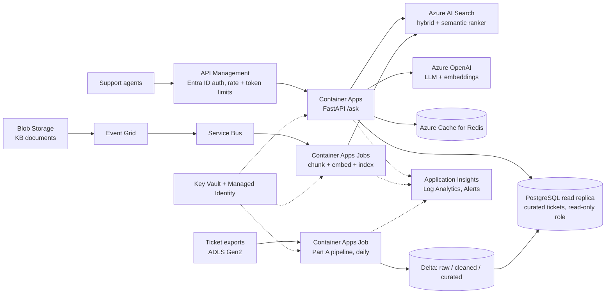

# Part D: Design Note

How the Support Ops Assistant would change at 100× scale, how it would run on Azure, the top risks, and what I would do next. Numbers refer to what was built and measured in Parts A-C.

## Contents

1. [At 100× the data](#1-at-100-the-data)
2. [Deployment and monitoring on Azure](#2-deployment-and-monitoring-on-azure)
3. [Top three risks](#3-top-three-risks)
4. [With another week](#4-with-another-week)
5. [Sources and assumptions](#sources-and-assumptions)

---

## 1. At 100× the data

Target: **2 million documents, 50 million tickets**. Today: 74 documents (796 chunks), about 4,200 tickets.

### What changes and what stays

| Area | Today | At 100× | Why |
|---|---|---|---|
| Document ingestion | Full rebuild on `/ingest` | Event-driven, incremental: only new, changed or deleted documents | A full rebuild of ~15M chunks would take hours and re-embed unchanged text |
| Ticket ingestion | One file per run, pandas, one transaction | Same contract, but files land in a data lake, and loads are partitioned by date | Daily volume grows to ~180k rows/day; the history table to tens of millions of rows |
| Ticket storage | DuckDB file | Parquet / Delta on Azure Data Lake Storage Gen2 (raw, cleaned, curated) + curated tables served from Azure Database for PostgreSQL | DuckDB can process 50M rows on one machine, but it is single-writer and not a shared service |
| Vector + keyword index | FAISS exact + in-memory BM25 | Azure AI Search: HNSW vectors + BM25 in one index, hybrid queries with RRF built in | Exact search does not scale to ~15M chunks; one managed index replaces two in-process ones |
| Re-ranking | Self-hosted cross-encoder on CPU | Azure AI Search semantic ranker (or the same cross-encoder on GPU) | Re-ranking was the measured bottleneck (~730 ms of ~745 ms) |
| SQL tool | Guarded SQL on DuckDB | Same guard, executed on a PostgreSQL read replica with a read-only role | The guard is engine-independent; the database enforces read-only a second time |

The design principles stay: raw → cleaned → curated layers, idempotent loads keyed on file hash, "only newer versions win" upserts, quarantine instead of drop, the SQL guard, abstention, and the golden-set evaluation.

### Ingestion

**Documents**

```
Blob upload/update/delete → Event Grid → Service Bus queue → indexing workers (Container Apps Jobs, scaled on queue length)
  → parse + heading-aware chunk → embed in batches → upsert/delete chunks in Azure AI Search
```

- **Incremental by content hash**: a manifest table stores `doc_id → content hash, chunk ids, indexed_at`. An unchanged hash is skipped. A changed document has its old chunks deleted and new ones added. A deleted document has its chunks removed.
- **Full re-embeds** (new embedding model, new chunking) build a second index in the background, run the golden set against it, then switch traffic. The old index stays as a rollback.
- **Throughput**: workers scale out on the queue. Embedding calls are batched, and uploads to the index go in batches of up to 1,000 documents.

**Tickets**

- The Part A pipeline logic is kept: file hash for idempotency, data quality checks, quarantine, and upsert where only newer versions win. Files land in ADLS; each daily file is processed as one batch.
- Storage becomes Delta tables partitioned by business date. Upserts use `MERGE` with the same `updated_at` rule. A forced reprocess of a day rewrites only that day's partition, instead of rebuilding the whole current-state table.
- Curated aggregates (resolution time per product, weekly backlog) are recomputed incrementally for affected weeks only, then published to PostgreSQL for low-latency reads.
- Compute: a daily file of ~180k rows still fits one container job (DuckDB over Parquet). Azure Databricks or Microsoft Fabric is the step up if volumes grow further or many teams share the lake.

### Storage and indexing (sizing)

| Item | Estimate | Basis |
|---|---|---|
| Chunks | ~15M (10-20M) | 5-10 chunks per document; today 10.8 per document for long technical articles |
| Embedding cost, full corpus | ~$45 one-time | 15M chunks × ~150 tokens × $0.02 per 1M tokens (`text-embedding-3-small`) |
| Daily re-embedding (1% change) | < $1/day | Same rate |
| Vector storage | ~92 GB at 1,536 dims (float32); **~8 GB** at 512 dims with int8 quantization | `text-embedding-3-small` supports shorter dimensions; Azure AI Search supports scalar quantization |
| Text + keyword index | ~30-40 GB | ~1 KB of text and metadata per chunk, plus the inverted index |
| Azure AI Search tier | **S1, 1 partition × 3 replicas** | S1 partition: 160 GB storage, 35 GB vector index. 3 replicas for availability and read throughput |
| Tickets | ~15 GB raw, ~3 GB Parquet | 50M rows × ~300 bytes; Parquet compresses ~5× |

Choosing 512-dimension, quantized vectors keeps the whole index in a single S1 partition. That decision must be validated on the golden set before adoption, the same way the Part C experiments were run. Without quantization the vectors need an S2 partition (150 GB vector limit), at 4× the price.

### Latency

Measured today (production configuration, 2-vCPU runner): dense + BM25 search ~14 ms, cross-encoder re-ranking ~730 ms p50 (p95 ~980 ms). With a real LLM, generation adds roughly 1-3 s.

| Step | At 100× | Plan |
|---|---|---|
| Retrieval | Azure AI Search hybrid query over ~15M chunks | HNSW keeps vector search sub-linear; filters are applied inside the index |
| Re-ranking | Biggest controllable cost | Semantic ranker (managed) or cross-encoder on GPU; re-rank 10-20 candidates, not more |
| Generation | Dominates once a real LLM is used | Stream the answer; cap context at 5 passages; short answers |
| Repeated questions | Common in support | Cache answers in Azure Cache for Redis, keyed by normalized question + filters + index version, so a re-index invalidates the cache automatically |
| SQL questions | Must not scan 50M rows | The tool queries curated tables (thousands of rows), with a statement timeout and row limit; detail queries go to indexed columns |

Target: **p95 under 3 seconds** for a full answer, with first tokens streamed in under 1 second.

### Cost (monthly estimate)

Assumption: **10,000 questions per day** (~300k per month), ~2,500 input and ~300 output tokens per answer.

| Component | Estimate per month | Basis |
|---|---|---|
| Azure AI Search S1 × 3 search units | ~$736 | $245.28 per search unit |
| Semantic ranker | ~$300 | $1 per 1,000 queries after the first 1,000 free |
| Azure OpenAI `gpt-4.1-mini` | ~$450 | 750M input tokens × $0.40/1M + 90M output × $1.60/1M |
| Embeddings | < $30 | Daily changes only |
| Container Apps (API, 3 replicas average, 1 vCPU / 2 GiB) | ~$230 | $0.000024 per vCPU-second, $0.000003 per GiB-second |
| PostgreSQL, Redis, storage, monitoring | a few hundred USD (estimate) | Small general-purpose tiers; not price-checked |
| **Total** | **roughly $2,000-2,500** | About $0.007-0.008 per question |

Cost levers, in order of impact:
- An answer cache: with 30% hit rate, LLM and ranker costs drop by roughly a third.
- Re-ranking only when the hybrid result is uncertain.
- Batch pricing for nightly evaluation runs.
- Reserved capacity for the search service once usage is stable.

---

## 2. Deployment and monitoring on Azure

### Architecture



### Services

| Service | Role | Notes |
|---|---|---|
| **Azure Container Apps** | FastAPI service | Minimum 2 replicas, autoscale on concurrent requests; revisions allow canary releases |
| **Container Apps Jobs** | Daily ticket pipeline (scheduled); indexing workers (event-driven, scaled on Service Bus queue length) | Same images as the API, different entry points |
| **Azure Container Registry** | Images | Built by GitHub Actions |
| **Azure AI Search** | Hybrid vector + BM25 index, semantic ranker, metadata filters | S1, 1 partition × 3 replicas |
| **Azure OpenAI** | `gpt-4.1-mini` for answers and SQL writing; `text-embedding-3-small` | Content filters and Prompt Shields on; separate deployments per environment |
| **ADLS Gen2 + Blob Storage** | Ticket files, Delta lake, KB documents | Lifecycle rules move old raw files to cool storage |
| **Event Grid + Service Bus** | Document change events → indexing queue | Dead-letter queue for failed documents |
| **Azure Database for PostgreSQL** | Curated ticket tables for the SQL tool | Read replica; role with `SELECT` on curated tables only; `statement_timeout` |
| **Azure Cache for Redis** | Answer and embedding cache | Keys include the index version |
| **API Management** | Single entry point: Entra ID authentication, per-user rate limits, per-team token quotas | Stops one client from causing a cost spike |
| **Key Vault + Managed Identity** | No secrets in images or environment files | Services authenticate to each other with managed identities |
| **Azure Monitor** (Application Insights, Log Analytics, Workbooks, Alerts) | Traces, metrics, logs, dashboards, alerting | OpenTelemetry from FastAPI; the PII-masking log filter stays in front of every log sink |
| **Cost Management** | Budgets and cost alerts | Budgets per environment and per service |

Networking: private endpoints for AI Search, OpenAI, PostgreSQL, Storage and Key Vault; the API is reachable only through API Management.

### Release process (GitHub Actions)

This extends the CI already in the repository:

1. Pull request: unit tests, pipeline end to end, offline evaluation.
2. Merge to main: build the image, push to Container Registry. GitHub authenticates to Azure with OpenID Connect (federated credentials), so no stored cloud secrets are needed.
3. Deploy to **staging**, then run the smoke test and the **golden set against staging**. The release is blocked if hit@1, abstention on unanswerable questions, or false refusals regress beyond a set tolerance.
4. Promote to **production** as a new Container Apps revision with 10% of traffic, watch the alerts, then move to 100%. Rollback means switching traffic back to the previous revision.

### Metrics and alerts

| Area | Metric | Alert (initial thresholds, tuned after a month of data) |
|---|---|---|
| Availability | 5xx rate | > 1% for 5 minutes |
| Latency | p95 `/ask` latency, split by retrieval / re-rank / LLM | p95 > 3 s for 10 minutes |
| Quality | "I don't know" rate | Outside the normal daily band (e.g. > 25% or < 3%) |
| Quality | Average top-passage confidence | Drops > 15% week over week (signals content drift or new question types) |
| Quality | Nightly golden-set run: hit@1, abstention, false refusals | Any metric drops > 5 points vs the last release |
| Quality | User feedback (thumbs down) per answer | > 10% of rated answers in a day |
| Safety | SQL guard blocks; prompt-injection flags; content-filter triggers | Spike above baseline (possible probing); every block logged with the masked question |
| Freshness | Index age: time since last successful indexing per source | > 24 hours |
| Freshness | Indexing queue depth and dead-letter count | Queue not draining for 1 hour; any dead-letter message |
| Pipeline | Daily ticket run status | Failure, or no run by 06:00 |
| Pipeline | Quarantine rate per file | > 15% (baseline ~8%, from Part A: 459 of 5,520 rows) |
| Pipeline | Data quality failures by check; freshness check; schema drift events | Freshness failure; any schema drift (notify, not page) |
| Cost | Tokens and cost per day; cost per question | Daily cost > 150% of the 7-day average; budget at 80% and 100% |
| Dependencies | Azure OpenAI 429 (throttling); AI Search throttling | Sustained throttling for 5 minutes |

Alerts go to Action Groups: paging (PagerDuty or on-call phone) for availability and pipeline failures, a Teams channel for quality, safety and cost signals. A Workbooks dashboard shows the quality metrics next to the system metrics, because a healthy service can still give bad answers.

---

## 3. Top three risks

### Risk 1: Hallucination (confident wrong answers)

**Why it matters here**: support agents may pass answers straight to customers.

| Layer | Already built | In production |
|---|---|---|
| Prevent | Answers only from retrieved passages; system prompt forbids outside knowledge; documents treated as data | Same, with a real LLM at `temperature=0` |
| Abstain | Confidence threshold (0.35, from the Part C sweep): 6 of 6 unanswerable questions refused | Threshold re-tuned on real questions; refusal rate monitored |
| Verify | Every claim carries a `[n]` citation; heuristic faithfulness check in evaluation | Run the faithfulness check online on a sample of answers; answers whose sentences are not supported by their citations are flagged or withheld |
| Detect | Golden set (34 questions) | Nightly golden set + user feedback + weekly human review of a sample |

Residual risk: Part C showed the hardest near-miss question (Django CSRF settings) scoring 0.28 against a 0.35 threshold, so the margin is thin. Showing citations with every answer lets agents check before trusting.

### Risk 2: Data leakage (customer data or internal data reaching the wrong person)

**Why it matters here**: the ticket store holds customer IDs and free text with emails and phone numbers (present in the synthetic data on purpose).

| Layer | Already built | In production |
|---|---|---|
| SQL access | 7-layer guard: single SELECT, table allowlist (no raw, quarantine or customer tables), no file or system functions, forced LIMIT; read-only connection with external access disabled | Same guard; PostgreSQL role with `SELECT` on curated tables only; row-level security by team |
| PII | Emails and phone numbers masked in all logs and in SQL results | Add Azure AI Language PII detection for names and addresses; log retention limits |
| Prompt injection | Instruction-like passages excluded; passages isolated in tags; system prompt | Prompt Shields on Azure OpenAI; injection-flag metric and alert |
| Access | None (local service) | Entra ID through API Management; document-level security trimming in AI Search, so users only retrieve documents they may see |
| Network | n/a | Private endpoints; no public access to data services |

### Risk 3: Stale index (answers based on outdated documents)

**Why it matters here**: a support answer citing an old process or a removed setting is wrong even if faithful.

| Layer | Already built | In production |
|---|---|---|
| Visibility | `last_updated` on every chunk, returned in every citation; `updated_after` filter | Same; the answer shows the source date |
| Freshness | Manual `/ingest` | Event-driven incremental indexing: a document change reaches the index in minutes |
| Deletions | Full rebuild drops removed documents | Delete events remove a document's chunks; a nightly reconciliation compares storage against the index manifest |
| Detection | n/a | Index-age and queue-depth alerts; cache keys include the index version so cached answers expire on re-index |

### Also watched: cost spikes

API Management per-user rate limits and per-team token quotas, a maximum context size (5 passages), the answer cache, budget alerts at 80% and 100%, and a daily-cost anomaly alert. A runaway client is throttled at the gateway before it reaches Azure OpenAI.

---

## 4. With another week

In priority order, driven by what Part C showed:

| # | Work | Why | Effort |
|---|---|---|---|
| 1 | **Bigger, independent golden set**: 150-200 questions from real support tickets, with a held-out split | The current 34 questions were written by the builder, and the confidence fix was tuned on them | 1.5 days |
| 2 | **Real LLM path + LLM judge**: run the evaluation with `gpt-4.1-mini` answering and judging; calibrate the judge against 30 human-graded answers | Correctness today is capped by the mock's sentence choice and strict string matching | 1 day |
| 3 | **LLM-written SQL behind the existing guard**, evaluated on 30 ticket questions with expected values | The rule-based writer missed "take the longest to close"; the guard already makes LLM SQL safe to try | 1 day |
| 4 | **Incremental indexing** by document hash, with deletions | Needed before any real document volume; enables the freshness metric | 0.5 day |
| 5 | **Answer cache + streaming responses** | Largest latency and cost win for repeated questions | 0.5 day |
| 6 | **Re-rank only when uncertain**: skip the cross-encoder when hybrid confidence is already high | Re-ranking is ~98% of current latency; measure the quality impact on the golden set | 0.5 day |
| 7 | **Terraform/Bicep for the Azure setup** and a staging deployment | Reproducible environments; makes the release gate in section 2 real | 1 day |

---

## Sources and assumptions

Prices checked in October 2026, US regions, pay-as-you-go. They change, so treat totals as order-of-magnitude.

- Azure AI Search tier limits (S1: 160 GB storage, 35 GB vector index per partition; S2: 512 GB / 150 GB; up to 36 search units): [Service limits for Azure AI Search](https://learn.microsoft.com/en-us/azure/search/search-limits-quotas-capacity)
- Azure AI Search prices (S1 $245.28 per search unit/month, S2 $981.12, S3 $1,962.24) and semantic ranker ($1 per 1,000 requests after 1,000 free): [Turbo360 Azure AI Search cost guide](https://azure-cost-management-playbook.turbo360.com/docs/ai-search), [Plan and manage costs of Azure AI Search](https://learn.microsoft.com/azure/search/search-sku-manage-costs)
- Azure OpenAI `gpt-4.1-mini` ($0.40 / 1M input, $1.60 / 1M output, standard tier): [CloudPrice: GPT-4.1 mini](https://cloudprice.net/models/gpt-4.1-mini), [Azure OpenAI pricing](https://azure.microsoft.com/en-ca/pricing/details/cognitive-services/openai-service/)
- `text-embedding-3-small` ($0.02 / 1M tokens): [Bifrost LLM cost calculator](https://www.getmaxim.ai/bifrost/llm-cost-calculator/provider/azure/model/text-embedding-3-small.md)
- Azure Container Apps consumption plan ($0.000024 per vCPU-second, $0.000003 per GiB-second): [DevZero: Azure Container Apps pricing](https://www.devzero.io/blog/azure-container-apps-pricing), [Azure Container Apps pricing](https://azure.microsoft.com/en-us/pricing/details/container-apps/)
- PostgreSQL, Redis, storage and monitoring costs are estimates, not price-checked.
- Workload assumptions: 10,000 questions/day, 2,500 input and 300 output tokens per answer, 5-10 chunks per document, ~150 tokens per chunk, 1% of documents changing per day.
