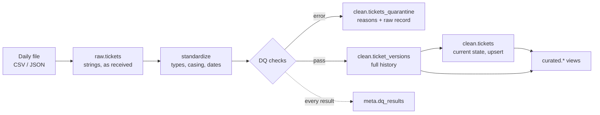

# Part A: Data Pipeline

Ingests daily support-ticket exports into DuckDB through raw, cleaned and curated layers, with data quality checks, quarantine, schema-drift handling and idempotent upserts.

## Contents

- [How to run](#how-to-run)
- [Synthetic data](#synthetic-data)
- [Architecture](#architecture)
- [Idempotency and upserts](#idempotency-and-upserts)
- [Data quality checks](#data-quality-checks)
- [Schema drift](#schema-drift)
- [Curated outputs](#curated-outputs)
- [Results](#results)
- [Technology choices](#technology-choices)
- [Tests](#tests)
- [Known limitations](#known-limitations)

## How to run

```bash
make setup
make all          # generate -> pipeline -> report -> test
make rerun        # reprocess day 2 to show idempotency
```

Or directly:

```bash
python -m pipeline generate                       # 3 messy daily files + reference data
python -m pipeline run                            # load all days (loaded files are skipped)
python -m pipeline run --day 2026-10-02           # load one day
python -m pipeline run --day 2026-10-02 --force   # reprocess one day
python -m pipeline report                         # print curated tables, write CSVs
python -m pipeline status                         # ingest log
python -m pipeline reset                          # delete the warehouse
```

## Synthetic data

[`scripts/generate_tickets.py`](../scripts/generate_tickets.py) is seeded and reproducible. It writes 5,520 rows over three daily files, plus customer and agent reference files.

| File | Rows | Contents |
|---|---|---|
| `tickets_2026-10-01.csv` | 2,060 | 2,000 new tickets + duplicates |
| `tickets_2026-10-02.csv` | 1,699 | 1,200 new + 450 updates of earlier tickets + duplicates |
| `tickets_2026-10-03.csv` | 1,761 | 1,200 new + 450 updates + 60 stale (older) versions + duplicates, new `Channel` column, title-cased headers |

Deliberate quality problems:

| Problem | Example |
|---|---|
| Exact duplicate rows | ~3% per file |
| Inconsistent casing and whitespace | `RESOLVED`, `In Progress`, `mobile-app`, `" tkt-000001 "` |
| Mixed date formats | `2026-09-27 12:03:00`, `2026-09-27T12:03:00Z`, `2026/09/27 12:03`, `27-Sep-2026 12:03`, epoch seconds |
| Invalid dates | `2026-13-45 99:00:00` |
| Logically wrong dates | `updated_at` before `created_at`, dates 30 days in the future |
| Nulls in key columns | `ticket_id`, `customer_id`, `priority`, `product` |
| Invalid values | status `WIP`, priority `P0`, product `Legacy CRM`, ticket id `TICKET#001234` |
| Broken references | unknown `AGT-999`, `CUST-9999` |
| Updates in later files | status moves forward, tickets get reopened |
| Out-of-order versions | day 3 resends older versions of some tickets |
| Schema drift | day 3 adds `Channel` and changes header casing |
| PII in free text | emails and phone numbers in `resolution_text` (used in Part B log masking) |

## Architecture



| Layer | Table | Purpose |
|---|---|---|
| Raw | `raw.tickets` | Every row exactly as received (all strings), plus batch id, source file, row number and load time. Append-only, so any value can be traced to its source. |
| Cleaned | `clean.ticket_versions` | Every valid version of every ticket, keyed `(ticket_id, updated_at)`. Needed to know when a ticket was actually resolved. |
| Cleaned | `clean.tickets` | Current state, one row per ticket. |
| Cleaned | `clean.tickets_quarantine` | Rows that failed an error-level check, with every failed check and the original record as JSON. |
| Cleaned | `clean.customers`, `clean.agents` | Reference data for referential checks. |
| Curated | `curated.*` | Reporting views. |
| Meta | `meta.ingest_log`, `meta.dq_results`, `meta.schema_changes` | Audit trail for every run. |

Code map:

| File | Responsibility |
|---|---|
| [`config.py`](../src/pipeline/config.py) | The data contract: expected columns, allowed values, thresholds |
| [`transform.py`](../src/pipeline/transform.py) | Pure cleaning functions, no database (unit tested) |
| [`quality.py`](../src/pipeline/quality.py) | Check definitions and runners |
| [`store.py`](../src/pipeline/store.py) | DDL, schema drift, quarantine, upsert |
| [`runner.py`](../src/pipeline/runner.py) | One file end to end in one transaction |
| [`curated.py`](../src/pipeline/curated.py) | Reporting views |
| [`cli.py`](../src/pipeline/cli.py) | Orchestration entry point |

## Idempotency and upserts

**File level**

- A file is identified by name + SHA-256 of its content.
- Same name and same content already loaded: skipped.
- Same name with different content (a corrected re-export), or `--force`: the file's earlier rows are removed from raw, versions, quarantine and DQ results, the file is reprocessed, and `clean.tickets` is rebuilt from history.
- Each file is processed in a single transaction. Any error rolls back the whole file, so a day is never half-loaded.

**Row level**

- Within one file, only the newest version of each ticket is applied.
- The upsert only replaces a stored ticket if the incoming version is strictly newer:

```sql
INSERT INTO clean.tickets (...) SELECT ... FROM batch
ON CONFLICT (ticket_id) DO UPDATE SET ...
WHERE EXCLUDED.updated_at > clean.tickets.updated_at
```

This makes re-runs no-ops and stops late-arriving stale versions from overwriting fresher data.

**Verified**

- Re-running a day is skipped.
- `--force` on day 2 gives identical row counts and an identical content hash of `clean.tickets`.
- Every ticket in `clean.tickets` equals its newest version in history (0 mismatches).

## Data quality checks

16 checks: 14 row-level, 2 dataset-level.

| # | Check | Severity | Rule |
|---|---|---|---|
| 1 | `ticket_id_not_null` | error | ticket_id present |
| 2 | `ticket_id_format` | error | matches `TKT-\d{6}` |
| 3 | `exact_duplicate_row` | error | identical copy of an earlier row in the same file (first copy kept) |
| 4 | `customer_id_not_null` | error | customer_id present |
| 5 | `status_allowed_values` | error | open, pending, in_progress, resolved, closed |
| 6 | `priority_allowed_values` | error | low, medium, high, urgent |
| 7 | `product_allowed_values` | error | billing, mobile_app, web_portal, api, integrations |
| 8 | `created_at_valid_date` | error | parses as a date |
| 9 | `updated_at_valid_date` | error | parses as a date |
| 10 | `updated_not_before_created` | error | updated_at >= created_at |
| 11 | `dates_not_in_future` | error | no later than file date + 1 day |
| 12 | `customer_id_referential` | error | exists in reference customers |
| 13 | `agent_id_referential` | error | exists in reference agents (null allowed: unassigned ticket) |
| 14 | `resolution_text_when_resolved` | warn | resolved/closed tickets have resolution text |
| 15 | `freshness` | warn | newest updated_at within 1 day of the file date |
| 16 | `min_row_count` | warn | file has at least 100 rows |

Behaviour:

- `error`: the row goes to `clean.tickets_quarantine` with every failed check listed and the original record. Nothing is silently dropped: for every file, raw rows = valid rows + quarantined rows.
- `warn`: the failure is logged, the row is kept.
- Every result, pass or fail, is stored in `meta.dq_results` and printed by `report`.

Adding a check is one entry in the `ROW_CHECKS` list in `quality.py`.

## Schema drift

- Column names are normalized before anything else (`Ticket_Id`, `ticket id`, `ticket-id` all become `ticket_id`), so header casing changes are not treated as drift.
- A new column (day 3 `channel`) is added as `VARCHAR` to `raw.tickets`, `clean.ticket_versions` and `clean.tickets` with `ALTER TABLE`, and logged in `meta.schema_changes`. Rows from earlier days show NULL.
- A missing expected column is logged, filled with NULL, and the rows then go through the normal checks.

## Curated outputs

**`curated.avg_resolution_by_product`**: resolved ticket count, average, median and p90 resolution hours per product. Median and p90 are included because resolution times are skewed.

**`curated.backlog_by_priority_week`**: for each week and priority, the open backlog at the end of the week, plus tickets created and resolved that week.

Definitions:

- `resolved_at` is the first time the ticket reached resolved/closed **after its last unresolved version**, so an earlier resolution of a reopened ticket is not counted. Only set if the ticket is currently resolved/closed.
- A ticket is in the backlog at the end of week W if it was created before W ended and was not resolved before W ended.

Assumption: the source has no `resolved_at` column, so it is derived from the `updated_at` of the version where the status changed to resolved/closed.

## Results

From a full run (`outputs/pipeline/`):

| File | Raw | Valid | Quarantined | Upserted |
|---|---|---|---|---|
| `tickets_2026-10-01.csv` | 2,060 | 1,888 | 172 | 1,888 |
| `tickets_2026-10-02.csv` | 1,699 | 1,573 | 126 | 1,411 |
| `tickets_2026-10-03.csv` | 1,761 | 1,600 | 161 | 1,424 |

Final state: 4,207 current tickets, 5,020 ticket versions, 459 quarantined rows.

| Product | Resolved | Avg hours | Median hours | P90 hours |
|---|---|---|---|---|
| api | 375 | 151.45 | 119.50 | 229.74 |
| billing | 374 | 135.53 | 107.25 | 219.70 |
| integrations | 432 | 137.14 | 114.00 | 225.00 |
| mobile_app | 420 | 152.94 | 116.00 | 238.10 |
| web_portal | 405 | 148.97 | 121.00 | 231.60 |

Output files:

| File | Contents |
|---|---|
| `avg_resolution_by_product.csv` | Resolution time per product |
| `backlog_by_priority_week.csv` | Weekly backlog per priority |
| `dq_summary.csv` | Every check result for every file |
| `quarantine_reasons.csv` | Quarantined rows by reason |
| `schema_changes.csv` | Detected drift |
| `ingest_log.csv` | One row per processed file |
| `table_counts.csv` | Row counts per layer |

## Technology choices

| Choice | Why | Alternative considered |
|---|---|---|
| DuckDB | Embedded, no server to run. Columnar SQL, `ON CONFLICT` upserts, transactions, `ALTER TABLE`. Reviewer can run it with one `pip install`. | Postgres: better for concurrent writers; the DDL ports with small changes. |
| pandas for cleaning | Row-level rules are plain functions that can be unit tested without a database. | Pure SQL: faster at scale, harder to unit test. |
| Explicit date formats | Formats are tried in a fixed order. pandas' inference can silently swap day and month. Unknown formats become null and are quarantined. | `dateutil` parsing: more permissive, less predictable. |
| History table + current table | History gives correct resolution times for reopened tickets and lets `clean.tickets` be rebuilt at any time. | Current table only: simpler, but loses resolution timing. |
| Views for curated layer | Always consistent with clean tables, no refresh step. | Materialized tables: needed at larger scale (see design note). |
| argparse CLI + Makefile | No extra dependency. Each command maps directly to an Airflow or Dagster task. | Prefect/Dagster: optional per the brief, adds setup for the reviewer. |

## Tests

`make test` runs 32 tests in [`tests/pipeline/`](../tests/pipeline/).

| File | Covers |
|---|---|
| `test_transform.py` | Column-name normalization, null tokens, ID/status/product normalization, all seven date formats, invalid dates, drift columns in `standardize`, latest-version selection |
| `test_quality.py` | Each error check fires on a crafted bad row, a good row passes all checks, duplicates flag only the second copy, warn checks do not quarantine, freshness |
| `test_pipeline.py` | Quarantine instead of drop, idempotent re-run and forced re-run, later version updates and stale version is ignored, schema drift adds a column, curated numbers on a known example |

## Known limitations

- Exact-duplicate detection is within one file. A duplicate of an already-loaded row across files is harmless: it has the same `(ticket_id, updated_at)` and is ignored by the history insert and the upsert.
- Two different versions of a ticket with the same `updated_at` are ambiguous; the first one loaded is kept.
- DuckDB allows one writer at a time. Fine for a daily batch; a shared multi-writer setup would use Postgres.
- Backlog for reopened tickets uses their final resolution, so a ticket that was resolved, reopened and resolved again counts as open between its creation and its final resolution.
