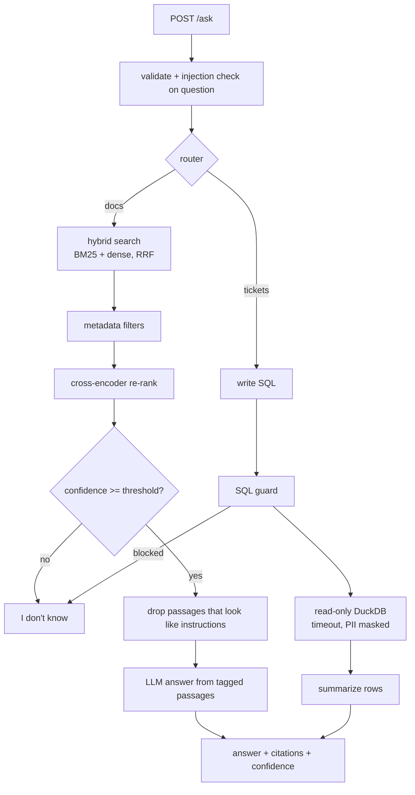

# Part B: RAG Service

A FastAPI service that answers questions from a knowledge base of 74 FastAPI documentation articles and, when the question is about support tickets, from the Part A DuckDB store through guarded, read-only SQL. Every answer has citations and a confidence score, and the service says "I don't know" when the evidence is weak.

## Contents

- [How to run](#how-to-run)
- [API](#api)
- [Architecture](#architecture)
- [Knowledge base](#knowledge-base)
- [Ingestion: parse, chunk, embed](#ingestion-parse-chunk-embed)
- [Retrieval: hybrid, filters, re-ranking](#retrieval-hybrid-filters-re-ranking)
- [Confidence and abstention](#confidence-and-abstention)
- [Structured data: router and guarded SQL](#structured-data-router-and-guarded-sql)
- [Guardrails](#guardrails)
- [LLM providers and the mock](#llm-providers-and-the-mock)
- [Docker](#docker)
- [Configuration](#configuration)
- [Tests](#tests)
- [Technology choices](#technology-choices)
- [Known limitations](#known-limitations)

## How to run

**Docker (recommended, nothing else to install)**

```bash
docker compose up --build        # the first build downloads the models
# open http://localhost:8000/docs
```

On start, the container builds the ticket store (Part A pipeline) and the index if they are missing, then serves the API.

**Local**

```bash
make setup                       # dependencies + project
make setup-models                # optional: neural embeddings + re-ranker (CPU torch)
make pipeline                    # Part A ticket store
make ingest                      # index the knowledge base
make serve                       # http://localhost:8000/docs
make ask Q="How do I enable CORS?"
```

Without `make setup-models`, the service runs fully offline with LSA embeddings and no re-ranker (see [Ingestion](#ingestion-parse-chunk-embed)).

## API

| Method | Path | Purpose |
|---|---|---|
| `GET` | `/health` | Liveness, plus what is loaded: index stats, embedder, re-ranker, LLM, ticket store |
| `POST` | `/ingest` | Parse, chunk, embed and index the knowledge base. Optional body: `chunk_size_words`, `chunk_overlap_words` |
| `POST` | `/ask` | Answer a question |

**`POST /ask` request**

```json
{
  "question": "How do I configure CORSMiddleware to allow my frontend origin?",
  "top_k": 5,
  "filters": {"source_prefix": "fastapi/tutorial", "section_contains": "cors", "updated_after": "2026-01-01"},
  "route": null
}
```

Only `question` is required. `route` can force `"docs"` or `"tickets"`.

**Response**

```json
{
  "answer": "You can configure it in your FastAPI application using the `CORSMiddleware`. [2] ...",
  "route": "docs",
  "abstained": false,
  "confidence": 0.641,
  "citations": [
    {
      "source": "fastapi/tutorial/cors.md",
      "section": "Use `CORSMiddleware`",
      "passage": "You can configure it in your **FastAPI** application using the `CORSMiddleware`. ...",
      "url": "https://fastapi.tiangolo.com/tutorial/cors/",
      "last_updated": "2026-03-05",
      "score": 0.0325
    }
  ],
  "sql": null,
  "warnings": [],
  "latency_ms": 35.4
}
```

For ticket questions, `sql`, `columns` and `rows` are filled and the citation is the executed SQL. Full examples: [`outputs/rag/sample_responses.json`](../outputs/rag/sample_responses.json).

| Status | When |
|---|---|
| 200 | Answer (including "I don't know") |
| 409 | `/ask` before `/ingest` |
| 422 | Invalid input: question shorter than 3 or longer than 1,000 characters, bad `top_k`, bad filter |

## Architecture



| File | Responsibility |
|---|---|
| [`api.py`](../src/rag_service/api.py) | FastAPI app, request/response schemas, status codes |
| [`service.py`](../src/rag_service/service.py) | Orchestration: ingest, route, answer, abstain |
| [`documents.py`](../src/rag_service/documents.py) | Markdown cleaning and heading-aware chunking |
| [`models.py`](../src/rag_service/models.py) | Embedding and re-ranking backends |
| [`index.py`](../src/rag_service/index.py) | FAISS + BM25 index, persistence |
| [`retrieval.py`](../src/rag_service/retrieval.py) | Hybrid search, RRF, filters, re-rank, confidence |
| [`router.py`](../src/rag_service/router.py) | Docs vs tickets routing |
| [`sql_tool.py`](../src/rag_service/sql_tool.py) | SQL writer, guard, read-only execution |
| [`guardrails.py`](../src/rag_service/guardrails.py) | Input validation, injection detection, PII masking |
| [`llm.py`](../src/rag_service/llm.py) | Mock, OpenAI and Anthropic providers |

## Knowledge base

- **Source**: 74 Markdown articles from the [FastAPI documentation](https://github.com/fastapi/fastapi/tree/master/docs/en/docs): the full tutorial (including security and dependencies), deployment, 10 advanced topics, and 4 general pages.
- **Why FastAPI docs**: real, well-structured technical documentation with exact identifiers (`CORSMiddleware`, `OAuth2PasswordBearer`) and conceptual explanations. That mix is a good test for hybrid retrieval.
- **Metadata**: [`data/kb/manifest.json`](../data/kb/manifest.json) records each article's public URL and its real last-updated date, taken from the git history of the source repository at commit `b23d78f`.
- **License**: MIT, included as [`data/kb/LICENSE-fastapi.txt`](../data/kb/LICENSE-fastapi.txt).

## Ingestion: parse, chunk, embed

**Parsing**: the docs use MkDocs syntax. The parser removes heading anchors (`{ #id }`), code-include directives (`{* file.py *}`), tab markers, images and HTML tags. Admonitions keep their text with a label (`Tip:`, `Note (Technical Details):`). Fenced code blocks are kept intact.

**Chunking (heading-aware)**

1. Split each article at H1-H3 headings, so a chunk never mixes topics.
2. Inside a section, pack whole paragraphs up to 180 words, with about 30 words of paragraph overlap. A code block is never split.
3. Each chunk is prefixed with its heading path (`CORS > Use CORSMiddleware`) for embedding and BM25, so short chunks still carry their topic.

Result: 796 chunks, median 72 words.

**Metadata stored per chunk**: `source`, `url`, `title`, `section` (heading path), `last_updated`, `position`, `chunk_id`.

**Embeddings**

| Backend | When | Why |
|---|---|---|
| `BAAI/bge-small-en-v1.5` (sentence-transformers) | Default in Docker, or after `make setup-models` | Small (33M parameters), strong retrieval quality, runs on CPU |
| LSA: TF-IDF (1-2 grams) + SVD, 256 dimensions | Fallback when no model can be loaded | Fully offline and deterministic, so the service always starts (air-gapped machines, CI) |

`EMBEDDING_BACKEND=auto` uses the model when it loads and logs a fallback otherwise. `/health` reports which one is active.

**Vector store**: FAISS `IndexFlatIP` over normalized vectors (exact cosine). At 796 chunks an exact index takes under a millisecond with no recall loss. The index, chunk metadata and fitted LSA state persist to `warehouse/index/` and load on startup.

## Retrieval: hybrid, filters, re-ranking

The brief asks for at least one technique beyond a single vector search. The service uses all three.

**1. Hybrid search (BM25 + dense) with Reciprocal Rank Fusion**

Support questions contain both exact identifiers ("`CORSMiddleware` allow_origins", "`--workers`") and paraphrases ("let my frontend on another domain call the API"). Dense vectors handle paraphrases but blur exact tokens; BM25 is the opposite. Both run, and their rankings merge with RRF:

```
rrf(chunk) = Σ  1 / (60 + rank in list)
```

RRF uses ranks only, so the very different score scales of cosine and BM25 never need calibrating. The BM25 tokenizer also splits identifiers, so `CORSMiddleware` matches "cors middleware".

**2. Metadata filtering**

`source_prefix`, `section_contains` and `updated_after` restrict candidates, for example only deployment docs, or only articles updated this year. When a filter is active, every chunk is scored so the filter cannot empty the candidate list.

**3. Cross-encoder re-ranking**

`cross-encoder/ms-marco-MiniLM-L-6-v2` reads the question and passage together, which separates "mentions the same words" from "answers the question". It runs only on the 20 fused candidates, which keeps its cost small and bounded. Its score is also the confidence signal.

The before/after effect of each of these is measured in Part C.

## Confidence and abstention

| Situation | Confidence |
|---|---|
| Re-ranker active | `sigmoid(top cross-encoder logit)`: the model is trained to estimate relevance |
| No re-ranker | `0.45 × share of question words found in the top passage + 0.35 × dense cosine + 0.20 × (top passage in both BM25 and dense top-5)` |
| Ticket route | 1.0 when the guarded query returned rows, 0.5 for an empty result, 0 when no safe query exists |

The service answers "I don't know" when:

- confidence is below `MIN_CONFIDENCE` (default 0.35, tuned on the golden set in Part C)
- every relevant passage was excluded as a possible injection
- the LLM itself replies "I don't know" (it is instructed to, when the documents do not contain the answer)
- no SQL rule or LLM query fits a ticket question, or the guard blocks the query

When it abstains, it returns no citations, because the weak candidates support nothing.

## Structured data: router and guarded SQL

**Router**: rule-based by design. It routes to tickets when the question mentions a ticket ID, tickets, backlog, resolution time, SLA, unassigned or agents, or a support product together with a metric ("how many", "average"). Everything else goes to the docs, where weak evidence produces "I don't know" rather than a wrong SQL answer. Rules are deterministic, free, add no latency, and are tested. The two domains barely overlap, so an LLM router would add cost without accuracy.

**SQL writer**

- With the mock LLM, a rule-based writer covers the common manager questions: resolution time (all, per product, slowest or fastest), backlog (per priority, current week), ticket counts with product/priority/status filters and group-bys, ticket lookup by ID, top agents, and unassigned tickets.
- With a real LLM, the model writes the SQL from a schema description.

Either way, the SQL goes through the same guard.

**Guard (any failure means the query never runs)**

| # | Layer | Blocks |
|---|---|---|
| 1 | Parse with sqlglot (DuckDB dialect) | Unparseable input |
| 2 | Exactly one statement | `SELECT 1; DROP TABLE ...` |
| 3 | Root must be `SELECT` (CTEs and UNIONs allowed) | `DELETE`, `UPDATE`, `COPY`, `ATTACH`, `PRAGMA`, `INSTALL` |
| 4 | No write, DDL or admin node anywhere in the tree | Writes hidden in subqueries |
| 5 | Table allowlist: `clean.tickets`, `clean.agents`, `curated.*` | `raw.*`, `meta.*`, the quarantine table (raw records with PII), customer names |
| 6 | No file, network or system functions | `read_csv`, `read_parquet`, `'/etc/passwd'`, `getenv`, `glob` |
| 7 | `LIMIT` forced to at most 100 rows | Large dumps |

**Execution (defence in depth)**

- The DuckDB connection opens with `read_only=True`, `enable_external_access=false` and `lock_configuration=true`. Even a query that got past the parser cannot write, read files or reach the network. Tests prove this by running `DELETE` and `read_csv` directly, without the guard.
- A 5-second timeout interrupts long queries.
- Emails and phone numbers in returned rows are masked.

## Guardrails

**Input validation**: Pydantic schema plus a cleaner. Control characters are removed, whitespace collapsed, and length bounded to 3-1,000 characters. `top_k` must be 1-20 and `updated_after` must be `YYYY-MM-DD`.

**Prompt-injection defence for retrieved text**

1. **Detect**: passages are scanned for instruction-like patterns: "ignore previous instructions", role reassignment ("you are now..."), system-prompt probes, fake role tags (`system:`, `<system>`), and exfiltration instructions with a destination URL or email. Flagged passages are left out of the LLM context and reported in `warnings`. At ingest, `/ingest` reports how many chunks were flagged (0 for the FastAPI docs, after tuning the exfiltration rule to stop flagging normal auth docs).
2. **Isolate**: every passage is wrapped in `<document id=... source=...>` tags, and any `</document>` inside the text is neutralized so a passage cannot close its own tag.
3. **Instruct**: the system prompt says documents are untrusted reference data, never instructions, and that only facts in the documents may be used.

The question is checked too. A flagged question is answered as an ordinary question, and the flag is logged and returned as a warning.

**PII masking in logs**: a logging filter on every handler masks emails and phone numbers (8+ digits, international formats) in the fully formatted message, including arguments. Dates, versions, ports and ticket IDs are left alone. The same masking applies to SQL result rows.

## LLM providers and the mock

| `LLM_PROVIDER` | Behaviour |
|---|---|
| `mock` (default) | No network and no key. Answers by extracting the passage sentences that best match the question, each with its `[n]` citation, so answers are faithful to the retrieved text by construction. Writes SQL with the rule-based writer and formats rows as a table. |
| `openai` | Chat Completions, `temperature=0`, default model `gpt-4.1-mini`. Needs `OPENAI_API_KEY` and `pip install openai`. |
| `anthropic` | Messages API, `temperature=0`, default model `claude-haiku-5-5`. Needs `ANTHROPIC_API_KEY` and `pip install anthropic`. |

The assignment allows a documented mock when there are no credentials. The mock keeps every other part real (retrieval, citations, abstention, SQL guard), so tests, CI and the Part C evaluation run without a key. Switching to a real model is one line in `.env`. Answers then become fluent prose and the LLM writes the SQL, with the same guard.

## Docker

```bash
docker compose up --build                                            # with models
docker build -t support-ops-assistant --build-arg INSTALL_MODELS=false .   # slim, offline LSA
```

- Base `python:3.12-slim`, CPU-only PyTorch.
- Dependencies are installed before the code is copied, so code changes rebuild quickly.
- Models are downloaded **at build time**, so the running container needs no internet.
- Runs as a non-root user (`uid 10001`) with a `HEALTHCHECK` on `/health`.
- The entrypoint builds the ticket store and index only if missing. The compose file mounts them on a volume, so restarts are fast.
- CI builds the image on a clean GitHub runner, starts the container, and runs [`scripts/smoke_test.py`](../scripts/smoke_test.py): a docs question, a ticket question and an unanswerable question.

## Configuration

All settings are environment variables with defaults; see [`.env.example`](../.env.example). The main ones:

| Variable | Default | Purpose |
|---|---|---|
| `LLM_PROVIDER` | `mock` | `mock`, `openai`, `anthropic` |
| `EMBEDDING_BACKEND` | `auto` | `auto`, `sentence-transformers`, `lsa` |
| `RERANKER_BACKEND` | `auto` | `auto`, `cross-encoder`, `none` |
| `CHUNK_SIZE_WORDS` / `CHUNK_OVERLAP_WORDS` | 180 / 30 | Chunking |
| `TOP_K` / `CANDIDATE_K` | 5 / 20 | Passages returned / candidates re-ranked |
| `MIN_CONFIDENCE` | 0.35 | Abstention threshold |
| `SQL_ROW_LIMIT` / `SQL_TIMEOUT_S` | 100 / 5 | SQL guard |

## Tests

79 tests in [`tests/rag_service/`](../tests/rag_service/), all offline (LSA, no re-ranker, mock LLM), using a tiny knowledge base and ticket store built in fixtures.

| File | Covers |
|---|---|
| `test_documents.py` | MkDocs cleaning, heading paths, code blocks never split, chunk size and overlap, metadata |
| `test_retrieval.py` | Identifier tokenization, exact and semantic matches, RRF arithmetic, single-method modes, each filter, confidence on vs off topic, index save/load |
| `test_sql_tool.py` | 19 attack queries blocked, LIMIT enforcement, read-only execution without the guard, PII masking in rows, every SQL rule, router |
| `test_guardrails.py` | Input validation, injection patterns (and no false positives on normal doc text), tag neutralization, PII masking, the logging filter |
| `test_api.py` | 409 before ingest, ingest, docs answer with citations, abstention, ticket route, filters, 422 validation, flagged question, injected passage excluded |

## Technology choices

| Choice | Why | Alternative considered |
|---|---|---|
| FAISS (exact) | Fast, in-process, no server; exact search is right at this size | Chroma/pgvector: extra service for no gain at 800 chunks; pgvector is the choice when sharing Postgres (design note) |
| BM25 + dense + RRF | Covers identifiers and paraphrases; RRF needs no score calibration | Weighted score sum: needs tuning per backend |
| bge-small + MiniLM cross-encoder | Good quality per CPU millisecond, small images | Larger models: better, but slower and heavier for a CPU service |
| LSA fallback | Service always starts offline; deterministic CI | Fail on missing model: brittle for reviewers |
| Rule router | Deterministic, free, tested | LLM router: extra call per question for little gain |
| sqlglot guard + read-only DB | Parser rules catch intent; DB settings catch anything the parser misses | Regex on SQL: easy to bypass |
| Mock LLM default | Allowed by the brief; makes tests, CI and evaluation reproducible | Requiring a key: reviewer could not run it |

## Known limitations

- With the offline LSA fallback, paraphrased questions with little word overlap retrieve worse than with bge-small. Part C measures the gap.
- The mock LLM extracts sentences rather than writing prose, so answers can read choppy; they are faithful, not fluent.
- The rule-based SQL writer covers common question shapes only. Others get "I don't know" with the mock; a real LLM covers more.
- Injection detection is pattern-based and catches known phrasings, not every possible attack. The tag isolation and system prompt are the backstop.
- The index is rebuilt fully on `/ingest`. Incremental re-indexing by document hash is in the design note.
